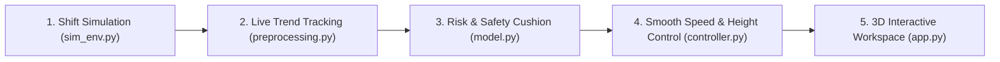

# AdaptiveCobot-HRC

[](https://github.com/randytirbhaw/AdaptiveCobot-HRC/actions/workflows/ci.yml)
[](pyproject.toml)
[](#how-it-works)
[](pyproject.toml)

### Robots that adapt to people—not the other way around.

On most factory floors, collaborative robots ("cobots") move at one preset speed and hand parts over at one fixed height. They treat a 5'1" teammate at the end of a long shift the exact same way they treat a 6'4" teammate first thing in the morning. That rigidity creates two everyday problems: workers strain their shoulders reaching to an awkward height, and fixed speeds either slow production down unnecessarily or feel uncomfortably fast when someone is tired.

**`AdaptiveCobot-HRC`** is an open-source Python engine and 3D simulation workspace built for human-centered manufacturing (Industry 5.0). It reads live signals from a shift—worker height, building fatigue, movement steadiness, and distance from the robot—and continuously adjusts the robot's **speed** and **handoff height** to keep work safe, comfortable, and productive.


#### What You're Seeing in the Demo
- **Left — 3D Shared Workspace:** A blue robotic arm hands parts across a station to a human coworker (white). The glowing ring on the floor marks the active safety buffer, shifting from **green** (normal pace) to **amber** (caution) or **red** (high risk) as conditions change.
- **Top & Middle Charts — Fatigue & Speed Control:** As the worker tires over the shift, the system adds a built-in safety margin (purple band) and smoothly dials back the robot's speed (green line). Around the **46-second mark**, a simulated sensor dropout occurs—the robot immediately drops to a safe `10%` crawl and ramps smoothly back up once clean readings return.
- **Bottom Chart — Comfortable Handoff Height:** Rather than locking handoffs to a fixed bench height, the arm raises or lowers its target (`ΔZ`) to meet the worker's natural elbow level, easing slightly lower as shoulder fatigue builds.

---

## How It Works



1. **Simulate Realistic Work Shifts (`src/sim_env.py`):** Models operators of different heights working through active assembly bursts and short recovery breaks, capturing how fatigue builds and how hand movements grow less steady over time.
2. **Track Short-Term Trends (`src/preprocessing.py`):** Summarizes recent sensor readings over a rolling window so the robot responds to real changes in worker state instead of overreacting to a single noisy measurement.
3. **Predict Risk with a Built-In Safety Cushion (`src/model.py`):** Pairs a fast machine learning risk estimator with a 95% confidence margin. Whenever signals look uncertain or unfamiliar, the buffer widens automatically so the robot errs on the side of caution.
4. **Adjust Speed & Reach Smoothly (`src/controller.py`):** Translates risk and worker height into smooth speed adjustments and ergonomic handoff positions—following industrial collaborative robot safety guidelines (ISO/TS 15066) while keeping an instant fail-safe override ready if a sensor malfunctions.
5. **Explore Everything in 3D (`app.py`):** Includes an interactive browser dashboard where you can change worker height, increase task intensity, or trigger sensor glitches and watch the robot respond in real time.

---

## Results & Real-World Impact

Tested across simulated shifts on unseen workers—comparing our adaptive engine against a standard fixed-speed robot and a basic rule-based setup:

- **Zero safety-zone violations (`0.0%` vs. `93.8%` with a fixed-speed robot):** The cobot respected safe speed boundaries across every test shift.
- **Natural, comfortable reach (`0.33 cm` average error):** Handoffs stayed within ~3 millimeters of each operator's ideal elbow height, down from over `6.3 cm` of mismatch on a static station.
- **More than double the safe output (`0.584` vs. `0.278`):** Because the robot slows down gradually and only as much as needed, it keeps work moving safely instead of slamming on the brakes at arbitrary cutoffs.
- **Instant decisions on standard hardware (`0.15 ms`):** Every control update runs in less than a fifth of a millisecond on a normal laptop CPU—no specialized AI hardware or GPU needed.

| Control Approach | Safety Violations (%) | Avg. Handoff Height Error | Speed Smoothness (\|Δv\|) | Safe Productivity Score |
| :--- | :---: | :---: | :---: | :---: |
| Fixed-Speed Robot (`85%` speed, fixed height) | 93.80% | 6.37 cm | 0.0000 | 0.053 |
| Simple Step-Down Rules | 39.00% | 6.37 cm | 0.0268 | 0.278 |
| **AdaptiveCobot-HRC (Ours)** | **0.00%** | **0.33 cm** | **0.0260** | **0.584** |

---

<details>
<summary><strong>Under the Hood: Robotics Standards, ML Architecture & Equations (Click to Expand)</strong></summary>

<br>

### 1. Biomechanical Fatigue ODE & Motor Noise (`src/sim_env.py`)
Operator muscle fatigue $F(t) \in [0, 1]$ evolves over task workload cycles $u_{\text{load}}(t)$ via Ma's differential fatigue-recovery law:

$$\frac{dF(t)}{dt} = k_{\text{fat}} \, u_{\text{load}}(t)\big(1 - F(t)\big) - k_{\text{rec}}\big(1 - u_{\text{load}}(t)\big)F(t)$$

Observed wearable fatigue incorporates Ornstein-Uhlenbeck drift, while hand velocity variance $\sigma_v^2(t)$ scales super-linearly ($\propto F(t)^{1.75}$) with stochastic micro-hesitation bursts.

### 2. Causal Online/Offline Feature Parity (`src/preprocessing.py`)
`TelemetryPreprocessor` (vectorized batch training) and `OnlineWindowBuffer` ($O(1)$ per-tick `collections.deque` ring buffer) maintain `1e-8` numerical parity across 10 causal features, standardized strictly on training episodes to prevent look-ahead leakage.

### 3. Monotonic Split-Conformal Dual-Head XGBoost (`src/model.py`)
Episodes are partitioned strictly by `worker_id` into disjoint **Train**, **Calibration**, and **Test** operator splits:
- **Monotonic Regression Head (`XGBRegressor`):** Enforces exact `monotone_constraints` (`+1` on fatigue, velocity variance, posture mismatch, and proximity hazard) so worsening physiological or kinematic indicators mathematically cannot reduce predicted risk $\hat{f}(\mathbf{x})$.
- **Split-Conformal Upper Bound:** Computes the finite-sample $(1 - \alpha)$ residual quantile on held-out calibration episodes ($n_{\text{cal}}$):

$$\hat{q}_{1-\alpha} = \text{Quantile}\!\left(\{r_i - \hat{f}(\mathbf{x}_i)\}_{i=1}^{n_{\text{cal}}},\; \frac{\lceil (n_{\text{cal}} + 1)(1 - \alpha) \rceil}{n_{\text{cal}}}\right), \qquad \hat{r}_{0.95}(\mathbf{x}) = \text{clip}\!\big(\hat{f}(\mathbf{x}) + \hat{q}_{0.95},\; 0,\; 1\big)$$

- **Supervisory Classification Head (`XGBClassifier`):** Outputs calibrated 3-class probabilities over `{NOMINAL, CAUTION, HIGH_RISK}`.

| Held-Out ML Metric | Score | Details |
| :--- | :---: | :--- |
| **Risk Regression $R^2$ / RMSE** | **0.925 / 0.033** | Histogram-binned monotonic `XGBRegressor` |
| **3-Tier Classification Macro-F1** | **0.886** | `NOMINAL` / `CAUTION` / `HIGH_RISK` |
| **`HIGH_RISK` Recall** | **100.0%** | Zero missed high-risk states on unseen operators |
| **Empirical Conformal Coverage** | **94.8%** | Target $1 - \alpha = 95.0\%$ ($\hat{q}_{0.95} = +0.056$) |
| **Single-Sample CPU Latency** | **0.15 ms** | Compatible with >1 kHz supervisory control loops |

### 4. ISO/TS 15066 Speed Scaling, Ergonomic ΔZ & 6-DOF Kinematics (`src/controller.py`)
Protective separation distance $S_p(t)$ (ISO/TS 15066 Clause 5.5.4) expands dynamically with the conformal upper bound $\hat{r}_{0.95}(t)$:

$$S_p(t) = v_H(t)(T_r + T_s) + C_{\text{intrusion}} + \big(Z_0 + \gamma_z \hat{r}_{0.95}(t)\big)$$

Commanded `v_scale` combines separation margin, ergonomic risk scaling, and tier ceilings through an asymmetric slew-rate limiter (fast braking, gentle acceleration) hard-clamped to `[0.10, 1.00]`. Vertical offset aligns the UR5e Denavit-Hartenberg 6-DOF tool flange with standing elbow height ($0.63 \, h_{\text{worker}}$) minus progressive shoulder-fatigue relief, clamped to `[-0.25, +0.25]` m:

$$\Delta Z(t) = \text{clip}\!\left((0.63 \, h_{\text{worker}} - z_{\text{bench}}) - \kappa_{\text{relief}}\,\hat{r}_{0.95}(t),\; -0.25,\; +0.25\right)$$

Any `NaN`, `Inf`, or out-of-bounds sensor input bypasses slew limiting and commands an immediate fail-safe state (`v_scale = 0.10`, `delta_z = 0.0` m).

</details>

---

## Try It Yourself

### 1. Set Up the Environment
Create an isolated Python environment and install the required packages:
```bash
python3 -m venv .venv
source .venv/bin/activate
pip install -r requirements.txt
```

### 2. Launch the Interactive 3D Workspace
Open the visual dashboard in your browser to adjust operator height, workload intensity, and sensor fault tests live:
```bash
streamlit run app.py
```

### 3. Run the Automated Safety & Quality Checks
Verify all model, kinematics, and safety-boundary tests:
```bash
pytest tests/ -v
```

### 4. Rebuild Sample Data & Demo Animation
Regenerate `data/synthetic_telemetry.csv`, benchmark metrics, and `assets/demo.gif`:
```bash
python -m scripts.render_demo
```

---

## Project Layout

```text
AdaptiveCobot-HRC/
├── .github/workflows/ci.yml      # Automated test checks on every push
├── assets/demo.gif               # Animated 3D workspace & live telemetry preview
├── data/synthetic_telemetry.csv  # Sample telemetry across 12 worker shifts (3,000 rows)
├── scripts/render_demo.py        # Generates dataset, benchmarks, and hero animation
├── src/
│   ├── sim_env.py                # Shift fatigue & movement simulator
│   ├── preprocessing.py          # Rolling trend extractor (batch & live streaming)
│   ├── model.py                  # Risk & safety-cushion prediction model
│   └── controller.py             # Speed/height controller & 3D arm kinematics
├── tests/test_pipeline.py        # Automated safety, accuracy, and boundary tests
├── app.py                        # Interactive 3D browser dashboard
├── pyproject.toml                # Package configuration
└── requirements.txt              # Python dependencies
```

---

## License

Released under the [MIT License](pyproject.toml).
