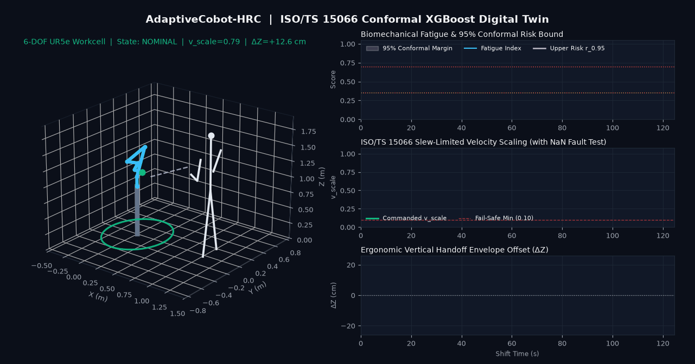

# AdaptiveCobot-HRC

[](https://github.com/randytirbhaw/AdaptiveCobot-HRC/actions/workflows/ci.yml)
[](pyproject.toml)
[](#4-isots-15066-supervisory-control--6-dof-kinematics-srccontrollerpy)
[](pyproject.toml)

**Adaptive Human-Robot Collaboration Engine** — an open-source Python simulation, uncertainty-aware machine learning, and supervisory control pipeline for **Industry 5.0 collaborative robotics**.

`AdaptiveCobot-HRC` ingests streaming human operator telemetry (anthropometrics, muscle fatigue dynamics, hand-velocity variance, and workspace separation) and modulates a 6-DOF industrial cobot's **velocity scaling (`v_scale`)** and **vertical handoff envelope (`ΔZ`)** in **~0.15 ms on CPU** with **split-conformal safety guarantees**.



---

## Key Engineering Highlights

- **Physiology-Grounded Telemetry Simulation (`src/sim_env.py`):** Models multi-operator assembly shifts via **Ma's Dynamic Muscle Fatigue-Recovery ODE**, signal-dependent motor jitter, Ornstein-Uhlenbeck wearable sensor drift, and periodic collaborative handoff trajectories.
- **Zero-Leakage Online/Offline Feature Parity (`src/preprocessing.py`):** Guarantees identical causal feature representations (`1e-8` numerical parity) between vectorized batch training and an $O(1)$ per-tick `collections.deque` ring buffer for real-time control loops.
- **Monotonic Split-Conformal Dual-Head XGBoost (`src/model.py`):**
  - Enforces **exact feature monotonicity** (`monotone_constraints`) so increasing operator fatigue or kinematic jitter mathematically cannot reduce predicted risk.
  - Calibrates **finite-sample split-conformal residuals** across held-out operator groups to supply a distribution-free **95% upper risk bound** ($\hat{r}_{0.95}$) alongside 3-tier supervisory regime probabilities (`NOMINAL`, `CAUTION`, `HIGH_RISK`).
- **ISO/TS 15066 Control, Slew Limiting & 6-DOF Kinematics (`src/controller.py`):** Couples Clause 5.5.4 Speed and Separation Monitoring (SSM) with Winter anthropometric elbow-height scaling, asymmetric acceleration/deceleration slew limiters, Denavit-Hartenberg UR5e kinematics, and instant deterministic fail-safe clamping on `NaN` or out-of-range sensor faults.
- **Interactive 3D Browser Digital Twin (`app.py`):** Streamlit + Plotly 3D engineering cockpit for sweeping operator stature, task load, conformal $\alpha$, and live sensor-fault injection.

---

## System Architecture

```mermaid
flowchart LR
    subgraph Sim["1. Biomechanical Workcell Sim (sim_env.py)"]
        ODE["Ma Fatigue ODE + Motor Jitter"] --> Stream["Telemetry Stream & Fault Injector"]
    end

    subgraph Prep["2. Causal Feature Layer (preprocessing.py)"]
        Stream --> Ring["Vectorized Window / O(1) Ring Buffer"]
        Ring --> Scaler["Train-Split StandardScaler"]
    end

    subgraph ML["3. Dual-Head Conformal ML (model.py)"]
        Scaler --> Reg["Monotonic XGBRegressor"]
        Scaler --> Clf["3-Tier XGBClassifier"]
        Reg --> Conf["95% Split-Conformal Bound"]
    end

    subgraph Ctrl["4. ISO/TS 15066 Supervisor (controller.py)"]
        Conf --> Law["SSM Speed + Anthropometric ΔZ"]
        Clf --> Law
        Law --> Clamp["Asymmetric Slew & Hard Safety Clamp"]
    end

    subgraph Twin["5. 3D Cobot Digital Twin"]
        Clamp --> Kin["UR5e 6-DOF DH + Damped IK"]
        Kin --> Viz["Streamlit 3D Cockpit & Hero GIF"]
    end
```



---

## Mathematical & Algorithmic Formulation

### 1. Dynamic Muscle Fatigue & Motor Variability (`src/sim_env.py`)
Operator fatigue $F(t) \in [0, 1]$ evolves over assembly load cycles $u_{\text{load}}(t)$ according to Ma's differential fatigue-recovery model:

$$\frac{dF(t)}{dt} = k_{\text{fat}} \, u_{\text{load}}(t)\big(1 - F(t)\big) - k_{\text{rec}}\big(1 - u_{\text{load}}(t)\big)F(t)$$

Hand kinematic variance $\sigma_v^2(t)$ exhibits signal-dependent motor noise ($\propto F(t)^{1.75}$) compounded by stochastic micro-hesitation bursts during elevated fatigue.

### 2. Monotonic Split-Conformal Risk Estimation (`src/model.py`)
To eliminate temporal window leakage, operator episodes are partitioned strictly by `worker_id` into disjoint **Train**, **Calibration**, and **Test** groups. Let $\hat{f}(\mathbf{x})$ denote the monotonic `XGBRegressor` point prediction. On the held-out calibration group of size $n_{\text{cal}}$, non-conformity residuals $e_i = r_i - \hat{f}(\mathbf{x}_i)$ define the finite-sample $(1 - \alpha)$ upper quantile:

$$\hat{q}_{1-\alpha} = \text{Quantile}\!\left(\{e_i\}_{i=1}^{n_{\text{cal}}},\; \frac{\lceil (n_{\text{cal}} + 1)(1 - \alpha) \rceil}{n_{\text{cal}}}\right), \qquad \hat{r}_{0.95}(\mathbf{x}) = \text{clip}\!\big(\hat{f}(\mathbf{x}) + \hat{q}_{0.95},\; 0,\; 1\big)$$

### 3. ISO/TS 15066 Supervisory Control & Ergonomic Handoff (`src/controller.py`)
The instantaneous protective separation distance $S_p(t)$ inflates uncertainty margins proportionally to the conformal upper risk bound $\hat{r}_{0.95}$:

$$S_p(t) = v_H(t)(T_r + T_s) + C_{\text{intrusion}} + \big(Z_0 + \gamma_z \hat{r}_{0.95}(t)\big)$$

Commanded velocity scaling fuses separation margin $v_{\text{SSM}}$, ergonomic risk scaling, and the `XGBClassifier` tier ceiling $v_{\text{cap}}(\hat{c})$, passed through an asymmetric slew-rate limiter and hard-clamped to `[0.10, 1.00]`. Simultaneously, vertical handoff offset aligns the UR5e tool flange with the operator's standing elbow height ($0.63 \, h_{\text{worker}}$) minus progressive shoulder-fatigue relief, clamped to `[-0.25, +0.25]` m:

$$\Delta Z(t) = \text{clip}\!\left((0.63 \, h_{\text{worker}} - z_{\text{bench}}) - \kappa_{\text{relief}}\,\hat{r}_{0.95}(t),\; -0.25,\; +0.25\right)$$

Any `NaN`, `Inf`, or out-of-range telemetry bypasses slew limiting and triggers an immediate fail-safe state (`v_scale = 0.10`, `delta_z = 0.0` m).

---

## Held-Out Generalization & Policy Benchmarks

Evaluated on unseen operator shifts (`seed=42`, disjoint `worker_id` test split, CPU-only execution):

### Predictive & Calibration Metrics
| Metric | Value | Notes |
| :--- | :---: | :--- |
| **Risk Regression $R^2$ / RMSE** | **0.925 / 0.033** | Monotonic `hist` `XGBRegressor` |
| **3-Tier Classification Macro-F1** | **0.886** | `NOMINAL` / `CAUTION` / `HIGH_RISK` |
| **`HIGH_RISK` Recall** | **100.0%** | Safety-critical regime sensitivity |
| **Empirical Conformal Coverage** | **94.8%** | Target $1 - \alpha = 95.0\%$ ($\hat{q}_{0.95} = +0.056$) |
| **Single-Sample CPU Latency** | **0.15 ms** | Compatible with >1 kHz supervisory loops |

### Closed-Loop Supervisory Policy Ablation
| Supervisory Policy | Safety Violation Rate (%) | Mean Ergonomic Z Error (cm) | Mean Command Jerk \|Δv\| | Safe Throughput Index |
| :--- | :---: | :---: | :---: | :---: |
| Static Nominal (`v=0.85, ΔZ=0`) | 93.80% | 6.37 cm | 0.0000 | 0.053 |
| Naive Reactive Threshold | 39.00% | 6.37 cm | 0.0268 | 0.278 |
| **Adaptive Conformal HRC (Ours)** | **0.00%** | **0.33 cm** | **0.0260** | **0.584** |

---

## Repository Structure

```text
AdaptiveCobot-HRC/
├── .github/workflows/
│   └── ci.yml                    # Multi-Python automated pytest matrix
├── assets/
│   └── demo.gif                  # 3D UR5e workcell + live telemetry hero animation
├── data/
│   └── synthetic_telemetry.csv   # Deterministic 12-operator shift telemetry (3,000 rows)
├── scripts/
│   └── render_demo.py            # Dataset generator, policy benchmark & GIF renderer
├── src/
│   ├── __init__.py               # Public package exports
│   ├── sim_env.py                # Biomechanical fatigue ODE & fault-injecting stream
│   ├── preprocessing.py          # Causal batch rolling features & O(1) online buffer
│   ├── model.py                  # Monotonic split-conformal dual-head XGBoost
│   └── controller.py             # ISO/TS 15066 supervisor & 6-DOF UR5e kinematics
├── tests/
│   └── test_pipeline.py          # Unit, parity, monotonicity & safety-clamp tests
├── app.py                        # Interactive 3D Streamlit + Plotly Digital Twin
├── .gitignore
├── pyproject.toml
├── requirements.txt
└── README.md
```

---

## Quickstart

### 1. Environment Setup
```bash
python3 -m venv .venv
source .venv/bin/activate
pip install -r requirements.txt
```

### 2. Run Unit, Parity & Safety Invariant Tests
```bash
pytest tests/ -v
```

### 3. Launch the Interactive 3D Workcell Digital Twin
```bash
streamlit run app.py
```

### 4. Regenerate Synthetic Dataset, Benchmarks & Hero GIF
```bash
python -m scripts.render_demo
```

---

## License

Released under the [MIT License](pyproject.toml).
